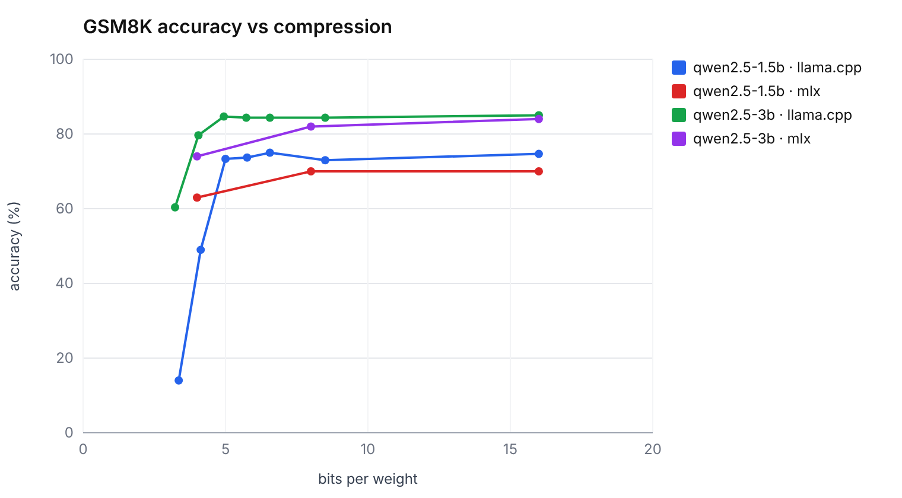
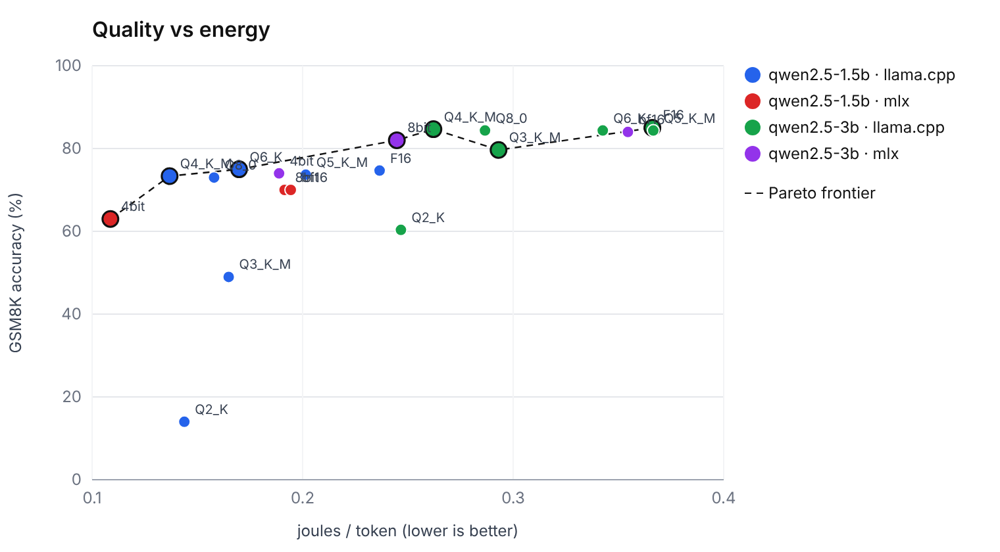
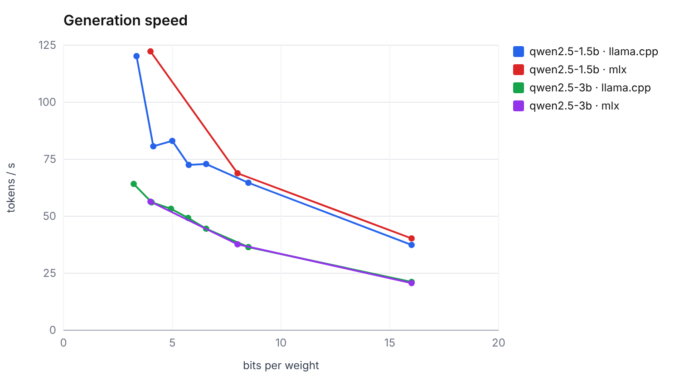
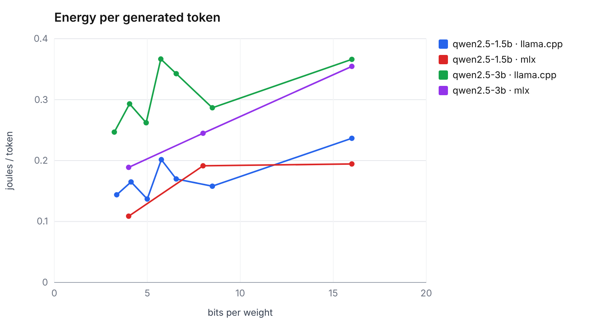
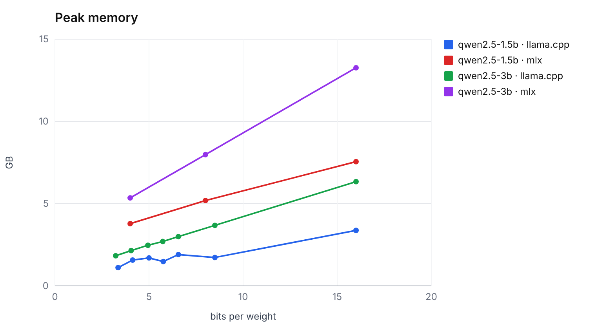
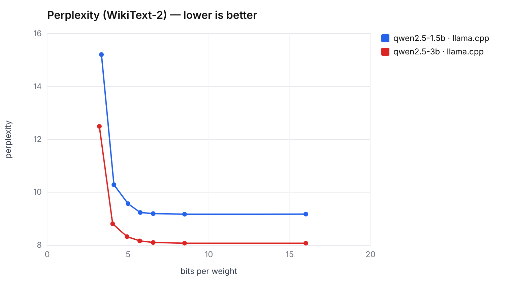
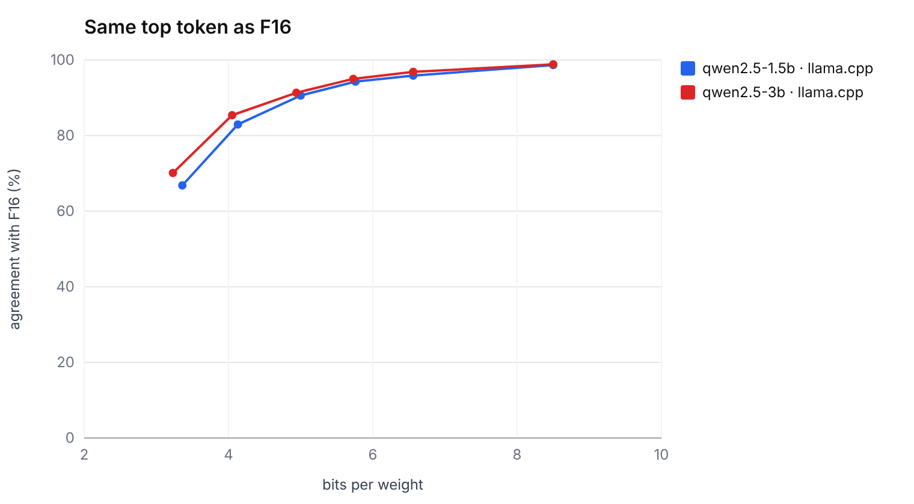
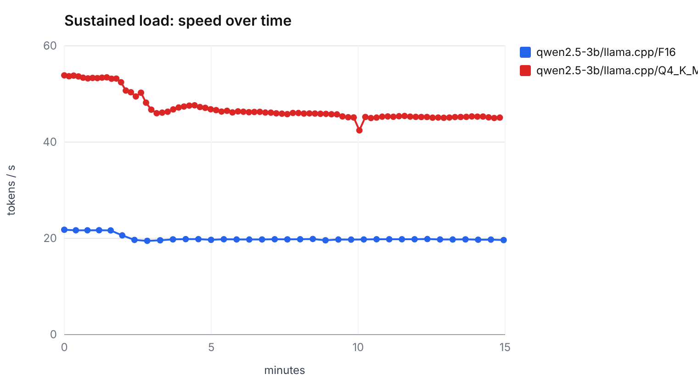

# joules-per-token

**What quantization really costs on a laptop: speed, memory, accuracy and energy of local LLMs on Apple Silicon.**

Quantizing a model from 16 to 4 bits makes it smaller and faster. The usual claim is that it is also "free" in quality and cheaper in energy. This project measures both claims end to end, on a fanless MacBook Air (Apple M5, 16 GB), across 20 configurations:

- 2 models of the same family: Qwen2.5-1.5B-Instruct and Qwen2.5-3B-Instruct
- 2 inference engines: llama.cpp (F16, Q8_0, Q6_K, Q5_K_M, Q4_K_M, Q3_K_M, Q2_K) and MLX (bf16, 8-bit, 4-bit)
- 6 axes per configuration: decode/prefill throughput, peak memory, energy per token, GSM8K accuracy, WikiText-2 perplexity, KL divergence from the F16 model, plus a 15-minute sustained-load run

The tool (`jpt`) has no runtime dependency beyond the Python standard library and reads Apple's hardware energy counters directly, without `sudo`.

## Key findings

| | Qwen2.5-3B F16 | Qwen2.5-3B Q4_K_M | Change |
|---|---|---|---|
| Decode throughput | 21.2 tok/s | 53.3 tok/s | ×2.5 |
| Energy per token | 0.366 J | 0.262 J | −28% |
| Peak memory | 6.3 GB | 2.5 GB | −61% |
| GSM8K accuracy (n = 300) | 85.0% [81–89] | 84.7% [80–88] | none |
| Same top token as F16 | 100% | 91.3% | −8.7 pts |
| Perplexity (WikiText-2) | 8.07 | 8.32 | +3% |

1. **Down to ~4 bits, no measurable accuracy loss.** On 300 GSM8K problems, the 3B model scores 85.0% in F16 and 84.3–84.7% in Q8_0, Q6_K, Q5_K_M and Q4_K_M; the 1.5B stays between 73.0% and 75.0% over the same range. The degradation is real but small: Q4_K_M still picks the same next token as F16 91% of the time (mean KL divergence 0.03). Below 4 bits it accelerates, and hits the smaller model harder: at Q3_K_M the 1.5B falls to 43% on GSM8K while the 3B holds 80%.
2. **A larger compressed model beats a smaller full-precision one.** The 3B at Q3_K_M (2.2 GB, 79.7%) beats the 1.5B at F16 (3.4 GB, 74.7%) with 35% less memory, and stays closer to its own F16 model than the 1.5B does at every quantization level.
3. **Speed improves far more than energy.** Decoding is memory-bandwidth bound: lighter weights are read faster, but the chip draws more power while doing so (7.8 W at F16, 13.4 W at Q4_K_M). Energy per token therefore drops by about a quarter, not by a factor of four.
4. **The engine matters as much as the format.** At 4 bits on the 3B model, MLX uses 28% less energy per token than llama.cpp (0.189 vs 0.262 J) at a similar speed, but its simpler 4-bit scheme costs 5 points on GSM8K (79.7% vs 84.7%), and 7 points on the 1.5B (66.7% vs 73.3%).
5. **Short benchmarks overstate sustained speed.** Under 15 minutes of continuous load the fanless chip throttles: Q4_K_M drops from 54 to 45 tok/s (−16%), F16 by −10%. The faster configuration draws more power and is throttled more.

**Recommended configuration on this machine:** Qwen2.5-3B Q4_K_M with llama.cpp. It matches F16 accuracy (84.7% vs 85.0%) with 2.5× the speed and 39% of the memory, and lies on the Pareto frontier of accuracy, throughput and energy.





## Charts

| | |
|---|---|
|  |  |
|  |  |
|  |  |

A short narrative of the findings: [`docs/WRITEUP.md`](docs/WRITEUP.md). Technical report (PDF): [English](docs/report_en.pdf), [français](docs/rapport_fr.pdf). Full results table and how to read it: [`results/final/report.md`](results/final/report.md). Raw data: [`summary.csv`](results/final/summary.csv), [`kld.csv`](results/final/kld.csv).

## Methodology

Detailed in [`docs/METHODOLOGY.md`](docs/METHODOLOGY.md). In short:

- **Throughput.** One unmeasured warm-up, then 3 trials per prompt separated by a 10 s pause, median reported with its coefficient of variation. Each configuration starts only once the chip is back to its nominal thermal state. Greedy decoding, fixed output length, prompt cache defeated so prefill is paid on every trial. llama.cpp timings come from the server; MLX timings from client-side stream timestamps.
- **Energy.** Cumulative IOReport *Energy Model* counters (CPU, GPU, ANE, DRAM) read just before and after each request, so there is no sampling or integration error. Idle power is measured before every variant and subtracted for the dynamic figure. Measurements wait until background CPU activity has settled.
- **Memory.** On Apple Silicon, model weights live in wired GPU memory that is not attributed to the server process. Peak memory is the increase in system wired memory plus the process footprint.
- **Quality.** GSM8K (first 300 test problems; chat template, exact match on the final number, 95% Wilson interval), WikiText-2 perplexity and KL divergence from the F16 model (`llama-perplexity`, 40 chunks of 512 tokens, llama.cpp only).
- **Compression.** Bits per weight are computed from file size and parameter count rather than from the quantization label.
- **Selection.** A configuration is on the Pareto frontier when no other one is at least as good on accuracy, throughput and energy, and strictly better on one.

## Quick start

Requires macOS on Apple Silicon and Python 3.11+.

```bash
HOMEBREW_NO_INSTALL_CLEANUP=1 brew install llama.cpp   # llama-server, llama-perplexity
python3 -m venv .venv && source .venv/bin/activate
pip install -e ".[mlx]"                                # drop [mlx] for llama.cpp only

jpt info                                               # chip, energy backend, idle power, thermal state
jpt sweep --config configs/quick.toml --download       # ~15 min smoke test
jpt report --session main
```

Full study (about 25 GB of weights, several hours, resumable):

```bash
jpt sweep --download
jpt thermal --variant qwen2.5-3b/llama.cpp/Q4_K_M --minutes 15
jpt report
```

Other commands: `jpt list`, `jpt fetch`, `jpt bench`, `jpt quality`. See `jpt <command> --help`.
For comparable energy figures, run on AC power with other applications closed and a fixed screen brightness.

## Project layout

```
src/jpt/
  cli.py       command-line entry point
  engine.py    llama-server / mlx_lm.server lifecycle, streaming, timings
  bench.py     warm-up, trials, per-request energy and memory, sustained-load run
  power.py     IOReport energy counters via ctypes, powermetrics fallback
  memory.py    wired-memory delta and process footprint
  thermal.py   macOS thermal state
  quality.py   GSM8K accuracy, perplexity
  sweep.py     all variants × all tasks, resumable
  stats.py     median, CV, Wilson interval
  report.py    summary table, Pareto frontier, charts, markdown report
  svg.py       dependency-free SVG charts
  store.py     SQLite schema
configs/       sweep.toml (full study), quick.toml (smoke test)
results/final/ report, charts and data of the study
tests/         unit tests against a fake inference server (no model required)
```

Tests: `python -m unittest discover -s tests`.

## Limitations and known issues

- **Scope.** One machine, one model family, two sizes. Results should not be extrapolated to 7B+ models or to chips with active cooling.
- **Statistical power.** 300 GSM8K problems give confidence intervals of about ±4 to 5 points; smaller differences are not significant.
- **Energy is measured for the whole SoC**, not the model alone. Idle subtraction and medians reduce, but do not remove, background noise.
- **Two 1.5B llama.cpp variants (Q3_K_M, Q2_K) remain unstable** (CV above 10%) even with pauses between trials; their throughput should be read as indicative.
- **MLX peak memory is likely overestimated**, because the wired-memory delta also includes MLX's buffer cache.

## Roadmap

- GSM8K on the full test set (1,319 problems)
- A 7–8B model to test whether the "larger and more compressed" result holds
- A second model family (Llama, Mistral or Gemma)
- Prefill/decode energy split and long-context behaviour (8k–32k tokens)

## Related work

- [asiai](https://pypi.org/project/asiai/): Apple Silicon LLM benchmarking CLI, whose benchmark protocol informed this one
- [apple-silicon-llm-bench](https://github.com/john-rocky/apple-silicon-llm-bench): cross-runtime benchmark with joules per token and thermal data
- Husom et al., *Sustainable LLM Inference for Edge AI* (2025), [arXiv:2504.03360](https://arxiv.org/abs/2504.03360)

This project differs by combining a full quantization sweep with measured accuracy, per-token energy and sustained-load behaviour, and by selecting configurations on a Pareto frontier.

## License

Code under the [MIT License](LICENSE). Model weights are distributed under their own licenses: Qwen2.5-1.5B under Apache 2.0, Qwen2.5-3B under the Qwen Research License (non-commercial).
