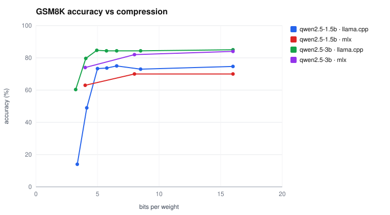
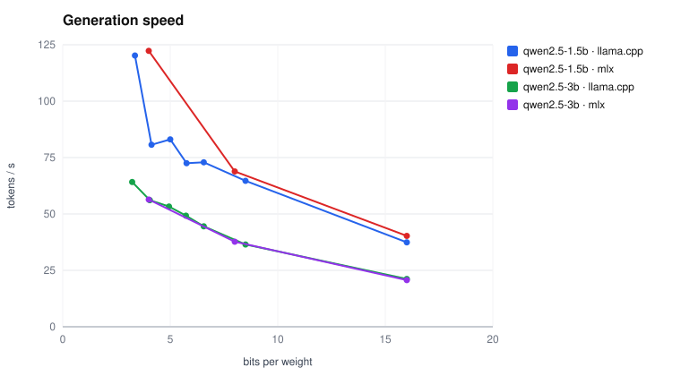
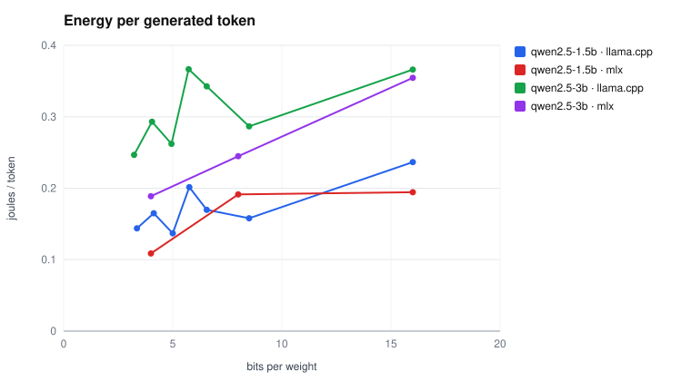
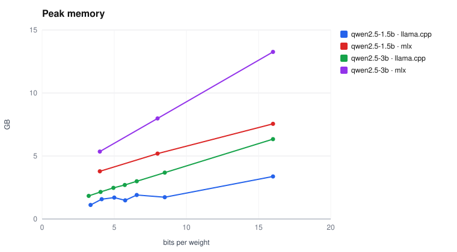
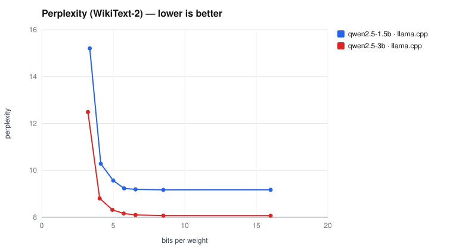
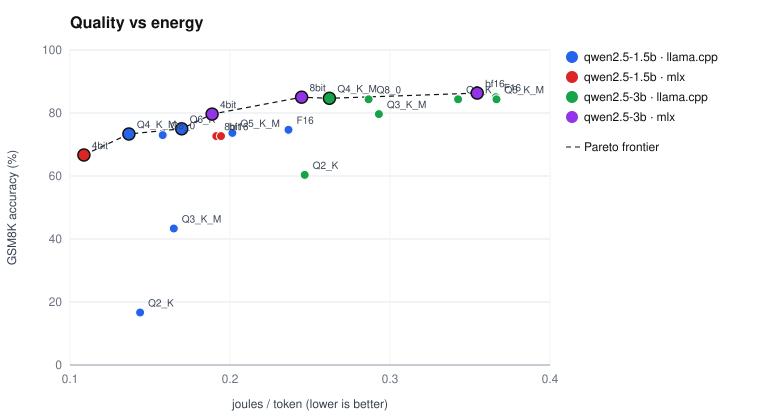
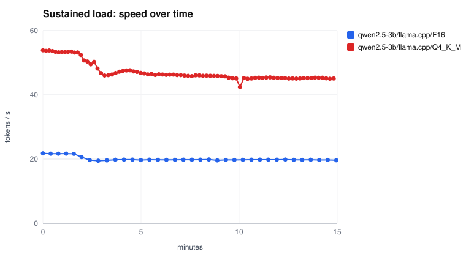
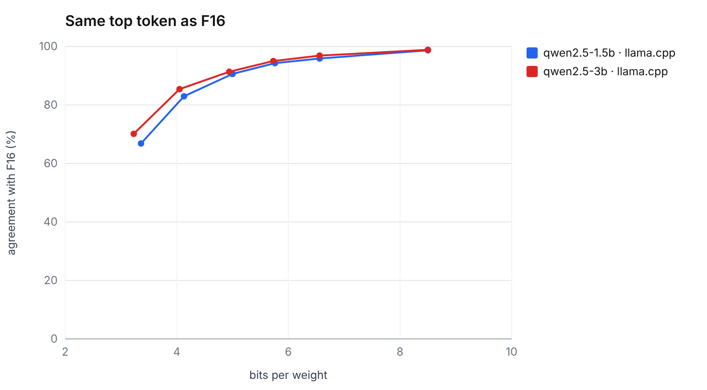

# Results — session `final`

| Variant | Bits/weight | Decode (tok/s) | Stability | Prefill (tok/s) | TTFT (ms) | J/token | J/token (idle-subtracted) | Memory (GB) | GSM8K | Perplexity | Pareto |
|---|---|---|---|---|---|---|---|---|---|---|---|
| qwen2.5-1.5b/llama.cpp/F16 | 16.00 | 37.4 | variable | 2490 | 398 | 0.237 | 0.184 | 3.37 | 74.7% (69%–79%) | 9.17 |  |
| qwen2.5-1.5b/llama.cpp/Q8_0 | 8.50 | 64.7 | variable | 2534 | 391 | 0.158 | 0.147 | 1.73 | 73.0% (68%–78%) | 9.17 |  |
| qwen2.5-1.5b/llama.cpp/Q6_K | 6.56 | 72.9 | stable | 2454 | 403 | 0.170 | 0.169 | 1.91 | 75.0% (70%–80%) | 9.19 | ★ |
| qwen2.5-1.5b/llama.cpp/Q5_K_M | 5.76 | 72.5 | stable | 2380 | 416 | 0.201 | 0.201 | 1.48 | 73.7% (68%–78%) | 9.23 |  |
| qwen2.5-1.5b/llama.cpp/Q4_K_M | 5.00 | 83.1 | stable | 2477 | 401 | 0.137 | 0.135 | 1.70 | 73.3% (68%–78%) | 9.57 | ★ |
| qwen2.5-1.5b/llama.cpp/Q3_K_M | 4.13 | 80.7 | unstable | 2442 | 405 | 0.165 | 0.165 | 1.57 | 43.3% (38%–49%) | 10.28 |  |
| qwen2.5-1.5b/llama.cpp/Q2_K | 3.36 | 120.2 | unstable | 2532 | 390 | 0.144 | 0.136 | 1.11 | 16.7% (13%–21%) | 15.21 |  |
| qwen2.5-1.5b/mlx/bf16 | 16.00 | 40.3 | stable | 2343 | 420 | 0.194 | 0.164 | 7.55 | 72.7% (67%–77%) | — |  |
| qwen2.5-1.5b/mlx/8bit | 8.00 | 68.8 | stable | 2366 | 417 | 0.191 | 0.181 | 5.19 | 72.7% (67%–77%) | — |  |
| qwen2.5-1.5b/mlx/4bit | 4.00 | 122.3 | stable | 2579 | 383 | 0.109 | 0.104 | 3.79 | 66.7% (61%–72%) | — | ★ |
| qwen2.5-3b/llama.cpp/F16 | 16.00 | 21.2 | stable | 1262 | 776 | 0.366 | 0.352 | 6.34 | 85.0% (81%–89%) | 8.07 |  |
| qwen2.5-3b/llama.cpp/Q8_0 | 8.50 | 36.5 | stable | 1268 | 771 | 0.287 | 0.281 | 3.68 | 84.3% (80%–88%) | 8.07 |  |
| qwen2.5-3b/llama.cpp/Q6_K | 6.56 | 44.5 | stable | 1237 | 791 | 0.343 | 0.338 | 2.99 | 84.3% (80%–88%) | 8.10 |  |
| qwen2.5-3b/llama.cpp/Q5_K_M | 5.73 | 49.2 | stable | 1191 | 822 | 0.367 | 0.362 | 2.70 | 84.3% (80%–88%) | 8.16 |  |
| qwen2.5-3b/llama.cpp/Q4_K_M | 4.94 | 53.3 | stable | 1241 | 788 | 0.262 | 0.258 | 2.47 | 84.7% (80%–88%) | 8.32 | ★ |
| qwen2.5-3b/llama.cpp/Q3_K_M | 4.05 | 56.1 | stable | 1213 | 806 | 0.293 | 0.288 | 2.15 | 79.7% (75%–84%) | 8.80 |  |
| qwen2.5-3b/llama.cpp/Q2_K | 3.23 | 64.2 | stable | 1275 | 766 | 0.247 | 0.243 | 1.83 | 60.3% (55%–66%) | 12.49 |  |
| qwen2.5-3b/mlx/bf16 | 16.00 | 20.7 | stable | 1234 | 801 | 0.355 | 0.338 | 13.26 | 86.3% (82%–90%) | — | ★ |
| qwen2.5-3b/mlx/8bit | 8.00 | 37.7 | variable | 1309 | 754 | 0.245 | 0.217 | 7.98 | 85.0% (81%–89%) | — | ★ |
| qwen2.5-3b/mlx/4bit | 4.00 | 56.4 | stable | 1426 | 692 | 0.189 | 0.175 | 5.35 | 79.7% (75%–84%) | — | ★ |

★ = on the Pareto frontier: no other variant is at once more accurate, faster and more energy-efficient.

## How to read

- **Bits/weight**: actual file size × 8 / parameter count (more reliable than the quantization label).
- **J/token**: whole-SoC energy (CPU + GPU + ANE + DRAM) during the request, divided by generated tokens.
- **Idle-subtracted**: the idle draw measured just before is removed — the cost of inference itself.
- **GSM8K**: in brackets, the 95% Wilson confidence interval. Variants whose intervals overlap are not significantly different.

## Divergence from the F16 model (llama.cpp)

| Variant | Bits/weight | Mean KL divergence | Same top token as F16 |
|---|---|---|---|
| qwen2.5-1.5b/llama.cpp/Q8_0 | 8.50 | 0.0004 | 98.7% |
| qwen2.5-1.5b/llama.cpp/Q6_K | 6.56 | 0.0044 | 95.9% |
| qwen2.5-1.5b/llama.cpp/Q5_K_M | 5.76 | 0.0107 | 94.3% |
| qwen2.5-1.5b/llama.cpp/Q4_K_M | 5.00 | 0.0362 | 90.6% |
| qwen2.5-1.5b/llama.cpp/Q3_K_M | 4.13 | 0.1144 | 82.9% |
| qwen2.5-1.5b/llama.cpp/Q2_K | 3.36 | 0.5246 | 66.8% |
| qwen2.5-3b/llama.cpp/Q8_0 | 8.50 | 0.0003 | 98.8% |
| qwen2.5-3b/llama.cpp/Q6_K | 6.56 | 0.0038 | 96.9% |
| qwen2.5-3b/llama.cpp/Q5_K_M | 5.73 | 0.0091 | 95.0% |
| qwen2.5-3b/llama.cpp/Q4_K_M | 4.94 | 0.0305 | 91.3% |
| qwen2.5-3b/llama.cpp/Q3_K_M | 4.05 | 0.1024 | 85.4% |
| qwen2.5-3b/llama.cpp/Q2_K | 3.23 | 0.4603 | 70.1% |

Measured with `llama-perplexity --kl-divergence` on 40 WikiText-2 chunks of 512 tokens.
