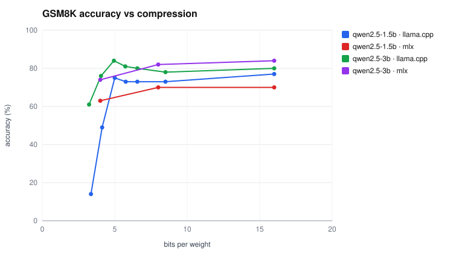
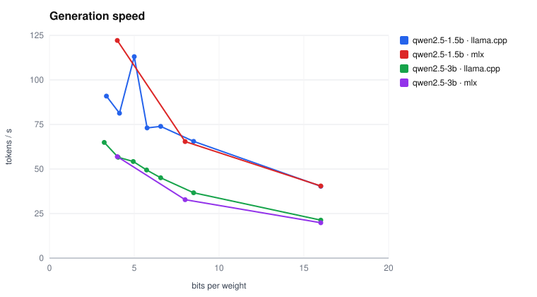
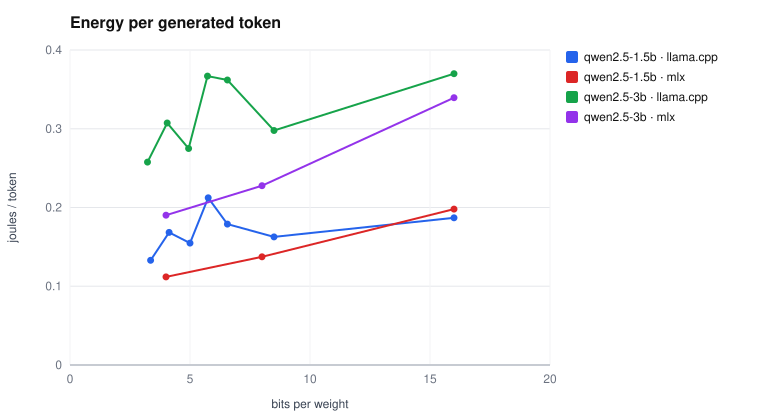
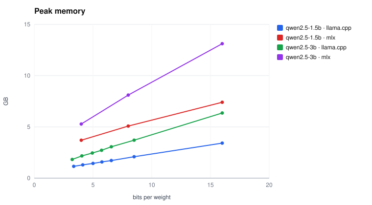
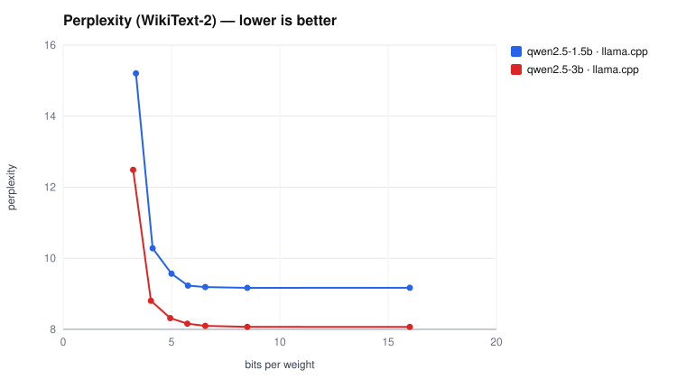
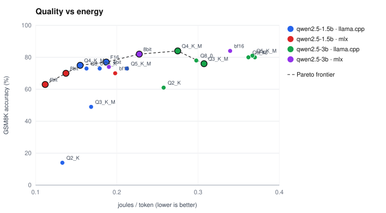
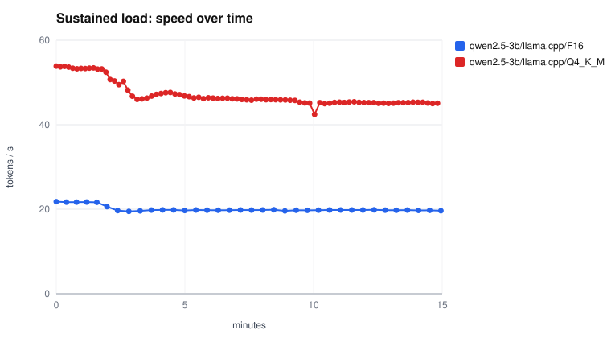

# Results — session `main`

| Variant | Bits/weight | Decode (tok/s) | Stability | Prefill (tok/s) | TTFT (ms) | J/token | J/token (idle-subtracted) | Memory (GB) | GSM8K | Perplexity | Pareto |
|---|---|---|---|---|---|---|---|---|---|---|---|
| qwen2.5-1.5b/llama.cpp/F16 | 16.00 | 40.3 | stable | 2062 | 480 | 0.187 | 0.180 | 3.42 | 77.0% (68%–84%) | 9.17 | ★ |
| qwen2.5-1.5b/llama.cpp/Q8_0 | 8.50 | 65.5 | stable | 2042 | 479 | 0.163 | 0.162 | 2.09 | 73.0% (64%–81%) | 9.17 |  |
| qwen2.5-1.5b/llama.cpp/Q6_K | 6.56 | 73.9 | stable | 1987 | 493 | 0.179 | 0.165 | 1.72 | 73.0% (64%–81%) | 9.19 |  |
| qwen2.5-1.5b/llama.cpp/Q5_K_M | 5.76 | 73.1 | unstable | 2432 | 405 | 0.212 | 0.212 | 1.58 | 73.0% (64%–81%) | 9.23 |  |
| qwen2.5-1.5b/llama.cpp/Q4_K_M | 5.00 | 113.1 | unstable | 2509 | 393 | 0.155 | 0.155 | 1.44 | 75.0% (66%–82%) | 9.57 | ★ |
| qwen2.5-1.5b/llama.cpp/Q3_K_M | 4.13 | 81.3 | variable | 2000 | 487 | 0.168 | 0.168 | 1.29 | 49.0% (39%–59%) | 10.28 |  |
| qwen2.5-1.5b/llama.cpp/Q2_K | 3.36 | 90.9 | unstable | 2053 | 478 | 0.133 | 0.133 | 1.15 | 14.0% (9%–22%) | 15.21 |  |
| qwen2.5-1.5b/mlx/bf16 | 16.00 | 40.5 | variable | 15834 | 61 | 0.198 | 0.173 | 7.41 | 70.0% (60%–78%) | — |  |
| qwen2.5-1.5b/mlx/8bit | 8.00 | 65.4 | unstable | 24938 | 39 | 0.137 | 0.129 | 5.08 | 70.0% (60%–78%) | — | ★ |
| qwen2.5-1.5b/mlx/4bit | 4.00 | 122.1 | stable | 35715 | 27 | 0.112 | 0.112 | 3.70 | 63.0% (53%–72%) | — | ★ |
| qwen2.5-3b/llama.cpp/F16 | 16.00 | 21.3 | stable | 1140 | 854 | 0.370 | 0.367 | 6.36 | 80.0% (71%–87%) | 8.07 |  |
| qwen2.5-3b/llama.cpp/Q8_0 | 8.50 | 36.7 | stable | 1142 | 854 | 0.298 | 0.297 | 3.70 | 78.0% (69%–85%) | 8.07 |  |
| qwen2.5-3b/llama.cpp/Q6_K | 6.56 | 45.1 | stable | 1064 | 911 | 0.362 | 0.361 | 3.06 | 80.0% (71%–87%) | 8.10 |  |
| qwen2.5-3b/llama.cpp/Q5_K_M | 5.73 | 49.4 | stable | 1023 | 953 | 0.367 | 0.366 | 2.72 | 81.0% (72%–87%) | 8.16 |  |
| qwen2.5-3b/llama.cpp/Q4_K_M | 4.94 | 54.2 | stable | 1105 | 882 | 0.275 | 0.274 | 2.45 | 84.0% (76%–90%) | 8.32 | ★ |
| qwen2.5-3b/llama.cpp/Q3_K_M | 4.05 | 56.6 | stable | 1155 | 841 | 0.307 | 0.307 | 2.17 | 76.0% (67%–83%) | 8.80 | ★ |
| qwen2.5-3b/llama.cpp/Q2_K | 3.23 | 64.9 | stable | 1120 | 864 | 0.258 | 0.257 | 1.82 | 61.0% (51%–70%) | 12.49 |  |
| qwen2.5-3b/mlx/bf16 | 16.00 | 19.9 | variable | 8716 | 110 | 0.339 | 0.338 | 13.12 | 84.0% (76%–90%) | — |  |
| qwen2.5-3b/mlx/8bit | 8.00 | 32.8 | variable | 14389 | 67 | 0.228 | 0.200 | 8.10 | 82.0% (73%–88%) | — | ★ |
| qwen2.5-3b/mlx/4bit | 4.00 | 56.9 | variable | 21887 | 44 | 0.190 | 0.180 | 5.28 | 74.0% (65%–82%) | — |  |

★ = on the Pareto frontier: no other variant is at once more accurate, faster and more energy-efficient.

## How to read

- **Bits/weight**: actual file size × 8 / parameter count (more reliable than the quantization label).
- **J/token**: whole-SoC energy (CPU + GPU + ANE + DRAM) during the request, divided by generated tokens.
- **Idle-subtracted**: the idle draw measured just before is removed — the cost of inference itself.
- **GSM8K**: in brackets, the 95% Wilson confidence interval. Variants whose intervals overlap are not significantly different.
